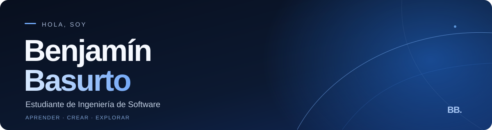

  

### Sobre mí

Soy **Benjamín Basurto**, estudiante de **Ingeniería de Software** en la **Universidad Técnica de Ambato, Ecuador**. Me gusta convertir ideas en proyectos reales y explorar nuevas formas de crear con tecnología.

Me interesan especialmente el **desarrollo web**, la **inteligencia artificial**, los **videojuegos** y la innovación. Actualmente sigo desarrollando mis habilidades mediante proyectos académicos y personales.

### Tecnologías y herramientas

**Con las que trabajo**

Java · Python · MySQL · Git · GitHub · Visual Studio Code · NetBeans

**Actualmente aprendiendo**

JavaScript · HTML · CSS · PHP · SQL · Bootstrap · jQuery · React

### Actividad en GitHub

  
  

Las estadísticas se basan en la actividad disponible públicamente; no indican por sí solas el nivel de experiencia.

### Mi página web

[**Visitar mi portafolio en GitHub Pages ↗**](https://99benjaminb.github.io/)

Sitio web personal desarrollado con HTML y CSS.

### Proyectos

- **[EduMonitor AI](https://github.com/GabrielRojas20/-EduMonitor-AI)** — proyecto académico colaborativo de software educativo.
- **[Mis repositorios](https://github.com/99benjaminb?tab=repositories)** — ejercicios, prácticas y proyectos en desarrollo.

---

  <strong>Siempre aprendiendo. Siempre construyendo.</strong>

