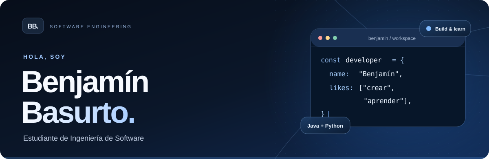
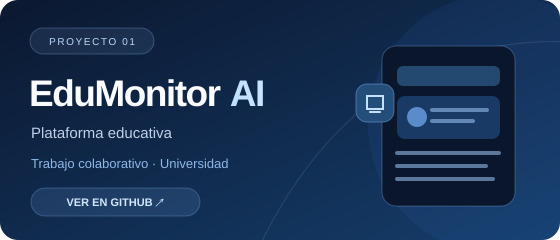
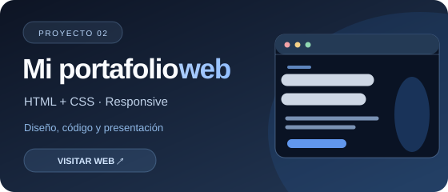
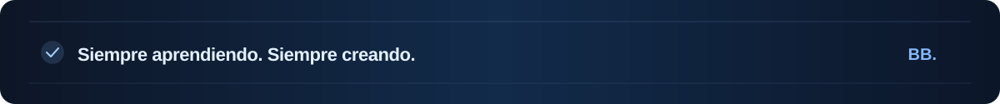

 

&nbsp;

 

## 👨‍💻 Un poco sobre mí

¡Hola! Soy **Benjamín Basurto**, estudiante de **Ingeniería de Software** en la **Universidad Técnica de Ambato, Ecuador**.

- 🎓 Me estoy formando en desarrollo de software y buenas prácticas de programación.
- 💡 Me motiva **convertir ideas en proyectos que funcionen**.
- 🌐 Exploro el **desarrollo web** y la **inteligencia artificial**.
- 🎮 Me interesan los **videojuegos** y su desarrollo.
- 🚀 Aprendo construyendo, experimentando y trabajando en equipo.

 

---

## 🧰 Tecnologías y herramientas

### ⚡ Con las que trabajo

 

### 🌱 Lo que estoy aprendiendo

 

---

## ✨ Proyectos destacados

<table>
  <tr>
    <td width="50%" valign="top">
      
      
<strong>EduMonitor AI</strong> Proyecto académico de desarrollo colaborativo.

    </td>
    <td width="50%" valign="top">
      
      
<strong>Mi portafolio web</strong> Mi espacio personal construido con HTML y CSS.

    </td>
  </tr>
</table>

---

## 📊 Mi actividad en GitHub

 

Las estadísticas son automáticas y reflejan únicamente la actividad disponible públicamente.

 

Hecho con curiosidad, código y ganas de seguir aprendiendo. · <a href="https://99benjaminb.github.io/">Visita mi web</a>

